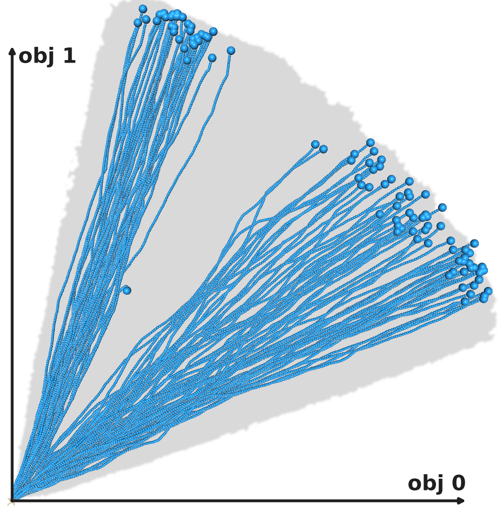
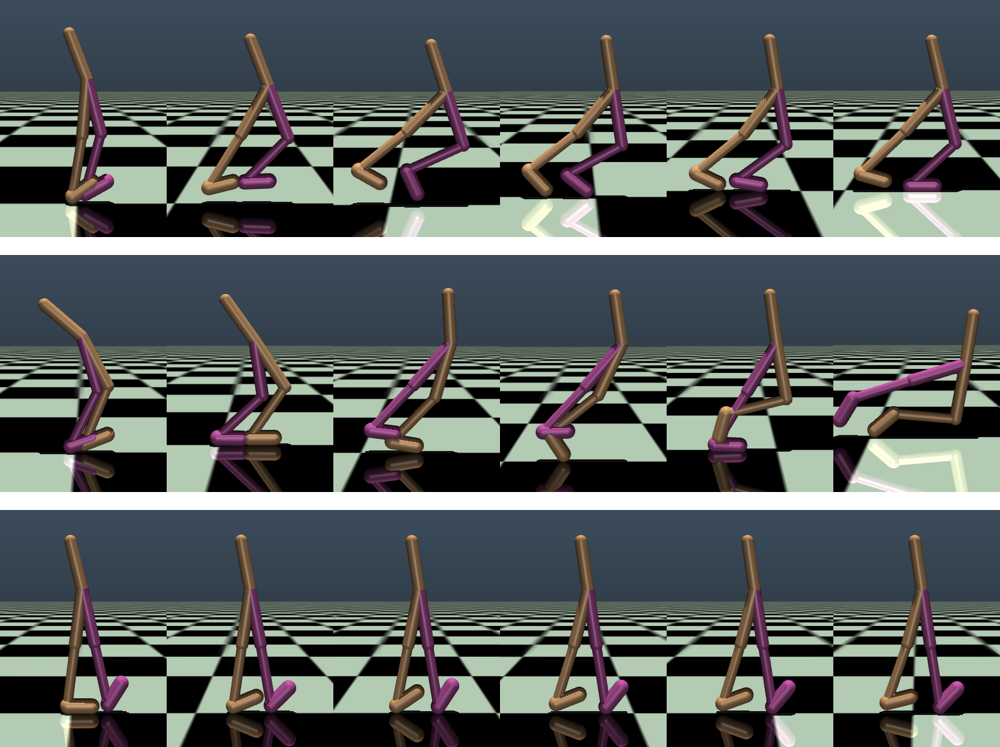
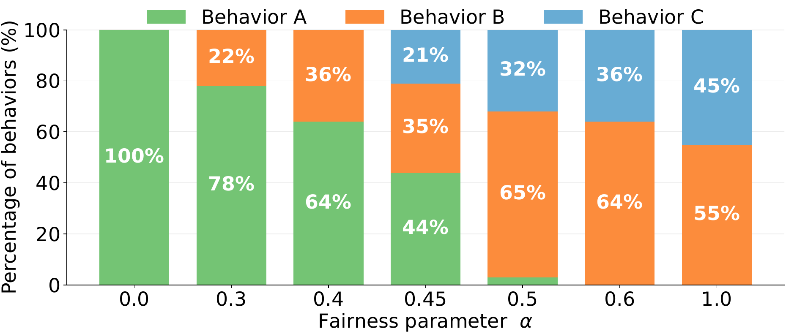

# AETDICE: Unified Framework and Offline Optimization for Nonlinear Multi-Objective RL

Woosung Kim, Youngjun Suh, Jinho Lee, Jongmin Lee, Byung-Jun Lee

**NeurIPS 2026**

[Paper (arXiv: TBD)]() · [OpenReview: TBD]()
<!-- TODO: add the arXiv / OpenReview links once they are public. -->

## Abstract

Optimizing nonlinear preferences in multi-objective reinforcement learning (MORL) captures complex trade-offs such as fairness or efficiency. However, the order of scalarization and expectation divides nonlinear MORL objectives into two distinct paradigms: Scalarized Expected Return (SER) and Expected Scalarized Return (ESR). SER requires global-level optimization and ESR requires non-Markovian policies, and the two have been addressed by separate optimization strategies. We unify them through the Aggregation–Expectation–Transformation (AET) framework. Through a tripartite decomposition of scalarization, AET recovers SER and ESR as special cases and also admits objectives that combine both levels of nonlinearity. Building on this framework, we propose AETDICE, a tractable offline RL algorithm for AET objectives. AETDICE absorbs the trajectory-level nonlinearity into a transformed per-step reward on an augmented state space and applies finite-horizon DICE-style density-ratio estimation, enabling sample-based optimization from static datasets. AETDICE addresses both requirements within a single method and captures the distinct trade-offs induced by AET objectives, including those that combine both levels of nonlinearity, which existing approaches do not address.

## Overview

An AET objective is $J(\pi) = G\big(\mathbb{E}_{\tau\sim\pi}[F(\mathbf{R}(\tau))]\big)$: a trajectory-level transformation $F$ of the return vector, an expectation, and an expectation-level aggregation $G$. Linear MORL, SER (linear $F$, concave $G$) and ESR (nonlinear $F$, linear $G$) are special cases.

| | |
|:---:|:---:|
|  |  |
| MO-Ant: 100 rollouts of AETDICE with convex $F$ and concave $G$; each trajectory specializes in one direction (gray: dataset coverage). | MO-Walker2d ($\rho=0.3$): Cobb-Douglas only, a walking and a falling episode of the same policy (top, middle); with the height safety utility (bottom). |



Fair-Taxi: distribution of behavior patterns of BSR-optimal policies as $\alpha$ moves from ESR ($\alpha=0$) to SER ($\alpha=1$).

## Installation

Python 3.9, JAX (CUDA 12) / Flax NNX, and the original MuJoCo 2.1 with `mujoco-py` (the D4MORL environments use `gym`'s `mujoco_env`). `numpy` must be 1.x for `mujoco-py`.

**MuJoCo 2.1**

```bash
mkdir -p ~/.mujoco
wget https://mujoco.org/download/mujoco210-linux-x86_64.tar.gz -O /tmp/mujoco210.tar.gz
tar -xzf /tmp/mujoco210.tar.gz -C ~/.mujoco/
sudo apt-get install -y libgl1-mesa-dev libgl1 libglew-dev libosmesa6-dev libglfw3 patchelf
```

**Option A: conda**

```bash
conda env create -f environment.yml
conda activate aet
```

`environment.yml` installs `jax[cuda12]`; for a CPU-only machine replace it with `jax`. The exact versions we used are pinned in `transfer/env_specs/aet_pip_freeze.txt` (jax/jaxlib 0.4.30, flax 0.8.5, numpy 1.24.1, mujoco-py 2.1.2.14).

**Option B: venv from the pinned freeze** (Debian/Ubuntu, needs `uv` and root for `apt`)

```bash
bash scripts/setup_aet_venv.sh      # creates ./.aetenv, installs MuJoCo 2.1 into ~/.mujoco
```

`d4rl`, `dm-control` and `mjrl` are listed in the freeze but are not imported by the training code; drop them from a copy of the freeze and pass it as `AET_FREEZE=<file>` if they fail to build.

**Shell setup.** All commands below are run from the repository root after

```bash
source scripts/aetenv.sh     # activates ./.aetenv (or $AET_VENV), sets MuJoCo LD_LIBRARY_PATH, WANDB_MODE=offline
export PYTHONPATH=$PWD
```

With conda, activate the env instead and set `export LD_LIBRARY_PATH=$HOME/.mujoco/mujoco210/bin:$LD_LIBRARY_PATH MUJOCO_PY_FORCE_CPU=1 XLA_PYTHON_CLIENT_PREALLOCATE=false`.

## Datasets

We use the D4MORL datasets (Zhu et al., 2023), `expert_uniform` and `amateur_uniform` splits, 50,000 trajectories each.

```bash
pip install gdown
# whole D4MORL collection
gdown --folder https://drive.google.com/drive/folders/1wfd6BwAu-hNLC9uvsI1WPEOmPpLQVT9k?usp=sharing --output environment/dataset
# or per environment
gdown --folder https://drive.google.com/drive/folders/1--_hS3NVt_zv8tplXTN0QrBvJpQeKqng?usp=drive_link   # MO-Ant
gdown --folder https://drive.google.com/drive/folders/1-AMBUEPsn9rdN5IcX5N50H0Itz4QKPWP?usp=drive_link   # MO-HalfCheetah
gdown --folder https://drive.google.com/drive/folders/10G1piVtFqXjQ98Q8fIdyCEWBxLMMcoo4?usp=drive_link   # MO-Walker2d
```

Two layouts are used (both are git-ignored):

* `./data/<Env>_50000_<split>_uniform.pkl`: flat layout used by the commands below (`DS=` / `--dataset_path`), e.g. `./data/MO-Walker2d-v2_50000_expert_uniform.pkl`.
* `./environment/dataset/<Env>/<Env>_50000_<split>_uniform.pkl`: the layout the sweep dispatcher (`src/train/run_AET_d4morl.py`) expects.

A symlink (`ln -s environment/dataset/MO-Ant-v2/MO-Ant-v2_50000_expert_uniform.pkl data/`) serves both. Reward-reshaped settings (Cobb-Douglas) cache the processed buffer under `<dataset dir>/_bufcache/` on first use (several GB per setting).

## Repository structure

```
src/
  train/            main.py (per-run entrypoint) · cli.py (all flags) · setup.py · loop.py
                    run_AET_d4morl.py + dispatcher.py + sweep_defs/ + sweeps_active.py (multi-GPU sweeps)
  learners/         AET_learner (AETDICE), FairDICE_learner (OptiDICE / FairDICE), IQL_learner (ESR-IQL), BC_learner
  nets/             policy (mixture-of-Gaussians, racc-conditioned), critic (nu, Q)
  data/             buffer.py (D4MORL loader, accumulated reward R^acc, transformed reward), reward_transform.py (Cobb-Douglas / safety reshapes)
  divergence/       phi-divergences (Pearson chi^2 is used in the paper)
  eval/             evaluate.py (rollout + all AET scores), rollout.py (re-evaluate a saved run), report.py (MO-Ant table)
  viz/              top-down MO-Ant renderer, Walker2d video / panorama renderer
  utility.py        F / G utilities (linear, exponential, piecewise-log, Cobb-Douglas)
environment/        MO-MuJoCo wrappers (MO-Ant, MO-Walker2d, MO-HalfCheetah, MO-Hopper, MO-Swimmer) + MuJoCo XML
experiments/
  paper_fig5/       cd_tables.py, walker_safe_cd_table.py (Tables 12-14), compose_walker_stack.py (Fig. 5b)
  walker/           fall_precursor_signals.py (fall-precursor AUC table), cd_fall_support.py
scripts/            run_branches_moant.sh (training launcher), queue_offline_gpu.sh, reeval_safe_score.sh,
                    render_cd_panorama.sh, render_ant_coverage.sh, aetenv.sh, setup_aet_venv.sh
assets/             figures used in this README
```

Most source comments are in Korean. Every run writes `<save_path>/<subdir>/<run_name>/{config.json, model/, eval/}`; `eval/final_returns.npy` holds the raw return vectors of the final 100-episode evaluation and `eval/final_episode_lengths.npy` the episode lengths.

## Running experiments

The single training entrypoint is `python -m src.train.main` (see `--help`). `scripts/run_branches_moant.sh` wraps it with the paper's D4MORL hyperparameters (4 x 512 MLPs, batch 512, Pearson $\chi^2$, $10^6$ steps, $\mu$ scaling $10^4$, horizon 500, 100 final evaluation episodes) and is configured through environment variables (`GPU`, `SEEDS`, `BETA`, `G`, `F`, `PREF`, `ENV`, `DS`, `RESHAPE`, `CD_RHO`, `CD_FORM`, `CD_SAFETY`, `THRESH`, `RSF`, `RACC_ENC`, `LEARNER`, `IQL_TAU`, `IQL_TEMP`, `STEPS`, `TAG_PREFIX`, `SAVE`). Logs go to `logs/<TAG>.log`. Always use `BRANCH=original` (the policy extraction used in the paper).

### D4MORL MO-Ant: convex $F$ with linear / concave $G$ (Table 1, Tables 8-9)

$F(\mathbf{x}) = \exp(\mathbf{x}/50)$; scores are computed on min-max normalized returns.

```bash
DS=./data/MO-Ant-v2_50000_expert_uniform.pkl

# AETDICE: convex F + concave G (G=piecewise_log, F=exponential_F, beta=1e-6 are the launcher defaults)
GPU=0 BRANCH=original SEEDS="1 2 3 4 5" TAG_PREFIX=aetdice DS=$DS bash scripts/run_branches_moant.sh

# AET-ESR: convex F + linear G, w=[0.5,0.5]
GPU=0 BRANCH=original SEEDS="1 2 3 4 5" G=linear F=exponential_F PREF="0.5 0.5" TAG_PREFIX=aetesr \
  DS=$DS bash scripts/run_branches_moant.sh
```
<!-- TODO: the beta used for the paper's AET-ESR row is not recorded in this code base; 1e-6 (launcher default) is an assumption. Paper grid: {1e-4, 1e-5, 1e-6}. -->

OptiDICE-$\mathbf{w}$ (FairDICE learner with linear $F$, linear $G$, three weights, $\beta=10^{-6}$), FairDICE (linear $F$, $G=\log$, $\beta=10^{-5}$) and ESR-IQL (linear $G$, convex $F$, three weights) are defined as sweeps in `src/train/sweep_defs/ant.py` (`ANT_EXPERT_OPTIDICE`, `ANT_EXPERT_FAIRDICE`, `ANT_EXPERT_IQL_EXP`). They are entries 11, 12, 13 of `SWEEPS` in `src/train/sweeps_active.py` (entry 10 is AETDICE, `ANT_EXPERT_PLOG_EXP_B6`):

```bash
python src/train/run_AET_d4morl.py --sweeps 11 12 13 --dry-run          # print the 35 commands
python src/train/run_AET_d4morl.py --sweeps 11 12 13 --gpu_indices 0,1  # run (dataset under ./environment/dataset/)
```

The amateur split (Table 9) and MO-Walker2d (Tables 10-11) use the corresponding `ANT_AMATEUR_*` / `WALKER2D_{EXPERT,AMATEUR}_*` definitions in `src/train/sweep_defs/`; add them to `SWEEPS` before launching.
<!-- TODO: the exact per-row beta / IQL hyperparameters behind the appendix MO-Ant amateur and MO-Walker2d tables were not re-verified for this release. -->

### D4MORL Cobb-Douglas utility on MO-Walker2d and MO-HalfCheetah (Tables 12, 14)

$F(\mathbf{x}) = x_1^{\rho}/x_2^{1-\rho}$ on the reshaped (forward speed, energy cost) rewards (`walker2dcd` / `half_cheetahcd`), computed from per-step averages (`CD_FORM=rate`), linear $G$. Common settings (expert split, 3 seeds):

```bash
W='BRANCH=original G=linear PREF="1 0" F=cobbdouglas RESHAPE=walker2dcd CD_FORM=rate RACC_ENC=rate ENV=walker2d DS=./data/MO-Walker2d-v2_50000_expert_uniform.pkl SAVE=./results_cd_walker_expert'
# later VAR=... assignments override the ones in $W

for RHO in 0.7 0.3; do
  # AET-CD
  eval "env $W GPU=0 SEEDS='1 2 3' BETA=1e-6 CD_RHO=$RHO TAG_PREFIX=cdexp_mog_b1e-6_rho$RHO bash scripts/run_branches_moant.sh"
done
# ESR-IQL (3e5 steps; expectile / temperature selected per rho from {0.8,0.9} x {10,14,18})
eval "env $W GPU=0 SEEDS='1 2 3' LEARNER=iql STEPS=300000 BETA=1e-6 CD_RHO=0.7 IQL_TAU=0.9 IQL_TEMP=18 \
      TAG_PREFIX=esriql_tau0.9_T18_rho0.7 bash scripts/run_branches_moant.sh"
eval "env $W GPU=0 SEEDS='1 2 3' LEARNER=iql STEPS=300000 BETA=1e-6 CD_RHO=0.3 IQL_TAU=0.9 IQL_TEMP=10 \
      TAG_PREFIX=esriql_tau0.9_T10_rho0.3 bash scripts/run_branches_moant.sh"
# BC (racc-conditioned, no filtering; independent of rho, re-scored for each rho)
eval "env $W GPU=0 SEEDS='1 2 3' LEARNER=bc BETA=1e-4 TAG_PREFIX=cdexp_bcracc_nofilter bash scripts/run_branches_moant.sh"
```

MO-HalfCheetah: replace `RESHAPE=half_cheetahcd ENV=half_cheetah DS=./data/MO-HalfCheetah-v2_50000_expert_uniform.pkl SAVE=./results_cd_halfcheetah_expert` and prefix the tags with `hc_`; ESR-IQL uses `IQL_TAU=0.9 IQL_TEMP=14` ($\rho=0.7$) and `IQL_TAU=0.9 IQL_TEMP=18` ($\rho=0.3$), BC uses `TAG_PREFIX=hc_bcracc_nofilter`.

### Cobb-Douglas with the height safety utility on MO-Walker2d (Tables 12-13)

Three reward channels (speed, cost, height margin $m^h_t$; reshape `walker2d_cd_safe_h`), $F = \log$ applied within each trajectory to the Cobb-Douglas utility and to the safety utility $x_s - R_{\mathrm{th}}$ with training threshold $R_{\mathrm{th}} = 1000$ (`CD_SAFETY=inlog`), linear $G$, $\beta = 10^{-3}$:

```bash
for RHO in 0.7 0.3; do
  eval "env $W GPU=0 SEEDS='1 2 3' BETA=1e-3 CD_RHO=$RHO RESHAPE=walker2d_cd_safe_h CD_SAFETY=inlog THRESH=1000 \
        G=linear PREF='1 1' RSF='1 1 1' TAG_PREFIX=safecd_b1e-3_h_inlog_th1000_rho$RHO bash scripts/run_branches_moant.sh"
done
```

Equivalent single run without the launcher:

```bash
python -m src.train.main --env_name walker2d --learner_type aet --extraction original \
  --utility_G_type linear --utility_F_type cobbdouglas --pref_weights 1 1 \
  --reward_reshape walker2d_cd_safe_h --cobbdouglas_rho 0.3 --cobbdouglas_form rate \
  --cobbdouglas_safety inlog --reward_threshold 1000 --racc_encoding rate \
  --divergence CHI --beta 1e-3 --seed 1 --batch_size 512 --hidden_dim 512 --num_layers 4 \
  --total_train_steps 1000000 --log_interval 100000 --chunk_size 5000 --eval_every_n_logs 2 \
  --final_eval_episodes 100 --max_seq_len 500 --mu_scaling_factor 1e4 --reward_scaling_factor 1 1 1 \
  --dataset_path ./data/MO-Walker2d-v2_50000_expert_uniform.pkl --save_path ./results_cd_walker_expert \
  --tag safecd_b1e-3_h_inlog_th1000_rho0.3_original_s1
```

**GPU queue.** `scripts/queue_offline_gpu.sh` starts runs one at a time on GPUs with free memory. Each line of the queue file (`QUEUE`, default `logs/offline_cd/queue_gpu.txt`) is a set of launcher variables on top of the Walker2d CD defaults above, e.g.

```
TAG_PREFIX=safecd_b1e-3_h_inlog_th1000_rho0.3 CD_RHO=0.3 SEEDS=1 BETA=1e-3 RESHAPE=walker2d_cd_safe_h CD_SAFETY=inlog THRESH="1000" G=linear PREF="1 1" RSF="1 1 1"
```

### Fair-Taxi and MO-PointMaze (Section 6.1, Appendix F)

<!-- TODO: the Fair-Taxi environment / dataset generator and the MO-PointMaze-2obj/3obj environments used in the paper are not part of this release. -->
The code for these experiments is not included in this release yet. (`environment/mo_pointmaze_v10.py` is a separate 10-objective point-mass environment and is not the MO-PointMaze of the paper.)

## Reproducing figures and tables

**Table 1 / Table 8 (MO-Ant).** `src.eval.report` re-scores the saved final evaluation of each run: the `w[0.5,0.5]` column is convex $F$ + linear $G$, and the concave-$G$ value is the `G,F` entry returned by `_eval_run`:

```bash
R=results_branches/rsf1.0to1.0_musf1e4
python -m src.eval.report --method "AETDICE=$(ls -d $R/*_aetdice_original_s* | paste -sd,)"
python -c "
import glob, numpy as np; from src.eval.report import _eval_run
c = [_eval_run(d, 100, None, False) for d in sorted(glob.glob('$R/*_aetdice_original_s*'))]
print({k: (np.mean([x[k] for x in c]).round(2), np.std([x[k] for x in c]).round(2)) for k in c[0]})"
```

`python -m src.eval.rollout --run_dir <run> --num_episodes 100` re-runs a policy and prints all scores (`score_G-log_F-exp`, `score_linear-exp_*`, ...).

**Tables 12-13 (Walker2d CD and safe-CD).** Baselines are trained without the safety channel, so every run is re-evaluated (100 episodes) with the height-margin channels recorded, then scored:

```bash
mkdir -p logs
ls -d results_cd_walker_expert/*/*{cdexp_bcracc_nofilter,esriql_tau0.9_T18_rho0.7,esriql_tau0.9_T10_rho0.3,cdexp_mog_b1e-6_rho0.?,safecd_b1e-3_h_inlog_th1000_rho0.?}*_s[123] > logs/safe_reeval_runs.txt
SCORE_RESHAPE=walker2d_cd_safe_hm OUT=safehm_100 PAR=3 bash scripts/reeval_safe_score.sh logs/safe_reeval_runs.txt
python -m experiments.paper_fig5.walker_safe_cd_table      # CD, safe-CD (R_th = 279.4), fall rate, satisfaction
```

**Table 14 (HalfCheetah CD).**

```bash
python -m experiments.paper_fig5.cd_tables --env half_cheetah \
  --iql_best 0.7=hc_esriql_tau0.9_T14_rho0.7 0.3=hc_esriql_tau0.9_T18_rho0.3   # "ESR-DICE" row = AET-CD
```

**Fall-precursor table (Appendix, Choice of the safety signal).** Re-runs the final evaluation of eight offline policies that fall (BC seeds 1-2, ESR-IQL and AET-CD at $\rho=0.7$, seeds 1-3) and reports per-step ROC AUCs for $k \in \{10, 25, 50\}$:

```bash
python -m experiments.walker.fall_precursor_signals --out results_viz/fall_precursor.json --runs <8 run dirs>
```
<!-- TODO: the mean / [min, max] over policies reported in the paper is aggregated from the per-run "auc" entries of the JSON; no script for that step is included. -->

**Figure 5(a) (MO-Ant rollouts over dataset coverage).**

```bash
RUN=results_branches/rsf1.0to1.0_musf1e4/G-plog_F-exp_F_beta1e-6_seed5_aetdice_original_s5 bash scripts/render_ant_coverage.sh
```

**Figure 5(b) (MO-Walker2d panoramas).** Render panorama PNGs per episode (`<name> <run_dir>` per line in the input file), then stack three of them:

```bash
FILTER=completes OUT=results_viz/walks bash scripts/render_cd_panorama.sh walks.txt   # walking episodes
FILTER=falls     OUT=results_viz/falls bash scripts/render_cd_panorama.sh falls.txt   # falling episodes
python -m experiments.paper_fig5.compose_walker_stack --n_pick 6 --out walker_stack.png \
  --rows CD:results_viz/walks/<name>_ep0.png Fall:results_viz/falls/<name>_ep1.png Safety:results_viz/safe/<name>_ep1.png
```

The paper figure uses AET-CD $\rho=0.3$, seed 1 (walking episode 0, falling episode 1) for the top two rows, and the AET-CD(safe) policy of Tables 12-13 ($R_{\mathrm{th}}=1000$, $\beta=10^{-3}$, $\rho=0.3$, seed 1, walking episode 1) for the bottom row.

## Results

**Table 1. MO-Ant (expert), AET objective values, mean ± std over 5 seeds.**

| Method | convex $F$ + linear $G$ | convex $F$ + concave $G$ |
|---|---:|---:|
| OptiDICE-[1.0, 0.0] | 729.61 ± 10.94 | 12.91 ± 0.03 |
| OptiDICE-[0.5, 0.5] | 689.23 ± 12.74 | 13.05 ± 0.04 |
| OptiDICE-[0.0, 1.0] | 1221.97 ± 26.71 | 12.25 ± 0.03 |
| FairDICE | 682.65 ± 20.06 | 13.04 ± 0.06 |
| ESR-IQL | **1243.33 ± 17.07** | 12.23 ± 0.02 |
| AET-ESR | 1067.22 ± 6.81 | 13.04 ± 0.12 |
| AETDICE | 949.73 ± 22.02 | **13.69 ± 0.05** |

**Table 12. MO-Walker2d Cobb-Douglas, mean ± std over 3 seeds (100 episodes each).** safe-CD utility uses the evaluation threshold $R_{\mathrm{th}} = 279.4$ (75th percentile of dataset safety returns); negative values indicate a violated threshold.

| Method | CD, $\rho=0.7$ | CD, $\rho=0.3$ | safe-CD, $\rho=0.7$ | safe-CD, $\rho=0.3$ |
|---|---:|---:|---:|---:|
| BC | 1.288 ± 0.286 | 0.730 ± 0.106 | −5659 ± 2841 | −5659 ± 2841 |
| ESR-IQL | 1.950 ± 0.043 | 0.789 ± 0.097 | −2356 ± 635 | −5234 ± 3025 |
| AET-CD | **2.048 ± 0.008** | 0.868 ± 0.049 | −1210 ± 184 | −3320 ± 1484 |
| AET-CD (safe) | 1.099 ± 0.007 | **0.948 ± 0.003** | **9.3 ± 1.2** | **9.7 ± 0.3** |

**Table 13. MO-Walker2d safety: fall rate (lower is better) and threshold satisfaction ($\sum_t m^h_t \ge 279.4$, higher is better).**

| Method | Fall, $\rho=0.7$ | Satisfaction, $\rho=0.7$ | Fall, $\rho=0.3$ | Satisfaction, $\rho=0.3$ |
|---|---:|---:|---:|---:|
| BC | 36.0 ± 19.8% | 26.3 ± 2.1% | 36.0 ± 19.8% | 26.3 ± 2.1% |
| ESR-IQL | 19.0 ± 2.9% | 1.0 ± 0.8% | 33.3 ± 16.0% | 22.3 ± 8.2% |
| AET-CD | 5.3 ± 0.5% | 0.7 ± 0.5% | 21.3 ± 8.1% | 21.3 ± 4.9% |
| AET-CD (safe) | **1.0 ± 1.4%** | **99.7 ± 0.5%** | **1.7 ± 1.7%** | **99.7 ± 0.5%** |

**Table 14. MO-HalfCheetah Cobb-Douglas, mean ± std over 3 seeds.**

| Method | CD, $\rho=0.7$ | CD, $\rho=0.3$ |
|---|---:|---:|
| BC | 1.833 ± 0.030 | 1.080 ± 0.010 |
| ESR-IQL | 2.344 ± 0.038 | **1.150 ± 0.003** |
| AET-CD | **2.416 ± 0.018** | 1.143 ± 0.001 |

Tables 12-14 are exactly what `walker_safe_cd_table.py` / `cd_tables.py` print for the runs behind the paper. For MO-Ant, re-training AETDICE with this code (5 seeds) gave 953 ± 25 (linear $G$) and 13.66 ± 0.03 (concave $G$).

## Citation

```bibtex
@inproceedings{kim2026aetdice,
  title     = {{AETDICE}: Unified Framework and Offline Optimization for Nonlinear Multi-Objective {RL}},
  author    = {Kim, Woosung and Suh, Youngjun and Lee, Jinho and Lee, Jongmin and Lee, Byung-Jun},
  booktitle = {Advances in Neural Information Processing Systems (NeurIPS)},
  year      = {2026}
}
```
<!-- TODO: update with volume / pages / URL once the proceedings are out. -->

## License

This code is released under the [MIT License](LICENSE).

## Acknowledgements

The D4MORL datasets and MO-MuJoCo environments are from Zhu et al., "Scaling Pareto-Efficient Decision Making via Offline Multi-Objective RL" (ICLR 2023).
